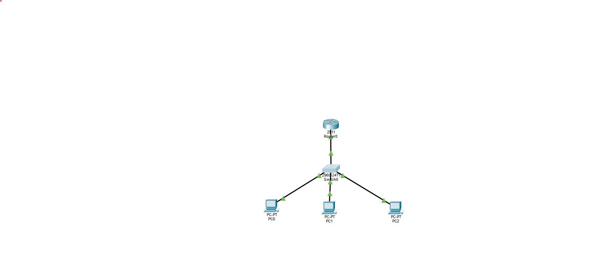

# Network Engineering Lab

A Cisco Packet Tracer lab built to practice network segmentation, VLAN configuration, IP subnetting, 802.1Q trunking, and inter-VLAN routing.

This project focuses on understanding how traffic moves between logically separated networks and how Layer 2 switching and Layer 3 routing work together.

## Topology

### Network Design

| VLAN | Name | Network | Gateway | Endpoint |
|------|------|---------|---------|----------|
| 10 | USERS | 192.168.10.0/24 | 192.168.10.1 | PC0 |
| 20 | ADMIN | 192.168.20.0/24 | 192.168.20.1 | PC1 |
| 30 | SERVERS | 192.168.30.0/24 | 192.168.30.1 | PC2 |

## What I Built

The network uses a Cisco 2960 switch and Cisco 2911 router.

Each endpoint is assigned to a separate VLAN and IPv4 subnet.

The switch access ports separate endpoint traffic into VLANs 10, 20, and 30. A single 802.1Q trunk connects the switch to the router.

The router uses subinterfaces on GigabitEthernet0/0 to provide a default gateway for each VLAN:

- `G0/0.10` — `192.168.10.1/24`
- `G0/0.20` — `192.168.20.1/24`
- `G0/0.30` — `192.168.30.1/24`

This router-on-a-stick configuration allows devices in separate VLANs to communicate while keeping the Layer 2 networks logically segmented.

## Switch Configuration

Access ports:

- `Fa0/1` → VLAN 10
- `Fa0/2` → VLAN 20
- `Fa0/3` → VLAN 30

The switch-to-router connection uses `Gi0/1` as an 802.1Q trunk carrying VLANs 10, 20, and 30.

## Verification

Connectivity was tested from the VLAN 10 workstation.

PC0 successfully reached:

- VLAN 10 gateway — `192.168.10.1`
- VLAN 20 workstation — `192.168.20.10`
- VLAN 30 workstation — `192.168.30.10`

Successful communication between VLANs verified that the trunk and router subinterfaces were operating correctly.

## Troubleshooting

During testing, VLAN 10 could reach its gateway while communication with VLANs 20 and 30 initially failed.

I isolated the issue by testing whether endpoints in each VLAN could reach their own default gateway. The problem was traced to incorrect IP addressing on the affected endpoints.

After correcting the addressing, inter-VLAN communication succeeded.

## Skills Practiced

- VLAN creation and assignment
- IPv4 subnetting
- Access port configuration
- IEEE 802.1Q trunking
- Router-on-a-stick
- Router subinterfaces
- Default gateway configuration
- Inter-VLAN routing
- ICMP connectivity testing
- Network troubleshooting

## Next Steps

Future versions of this lab will expand the topology with additional switching, trunk links, and ACL-based traffic controls.